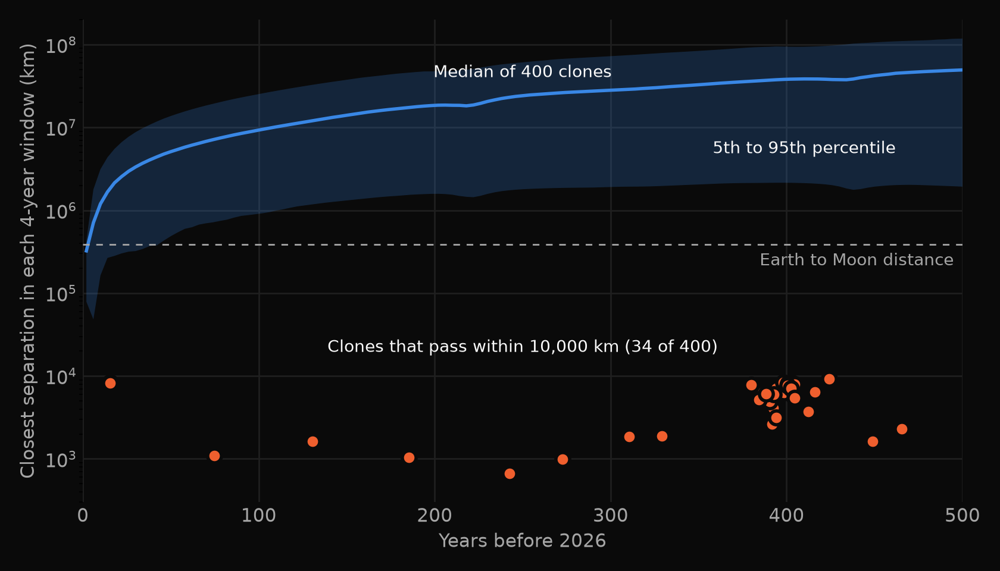
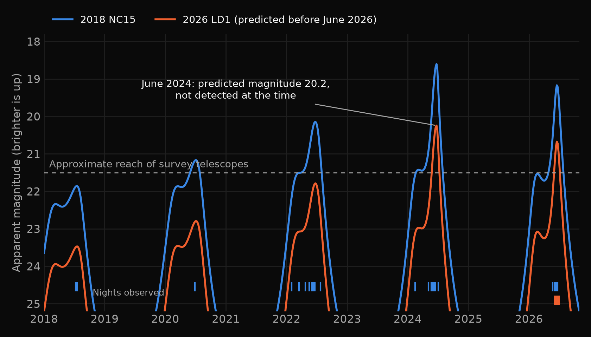

Two near-Earth asteroids, 2018 NC15 and 2026 LD1, are on almost the same
orbit. When they passed Earth in June 2026 they were about 500,000 km apart.
As of November 2026 the gap is about 310,000 km, which is less than the
distance from the Earth to the Moon. I could not find any publication that
links them. This article describes how the pair turned up, the checks I ran,
and the limits of what the data can show today.

This is a candidate, not a confirmed result. It has not been peer reviewed.

## Summary

- 2018 NC15 was discovered in 2018 and has been tracked for eight years.
  2026 LD1 was discovered on 5 June 2026 and has a 27-day observation arc.
- Their orbits match more closely than any other pair of distinct objects in
  the near-Earth asteroid catalog.
- The Catalina Sky Survey measured both objects in the same minute, on two
  nights, 1.25 degrees apart. They are two bodies, not one object entered
  twice.
- 2026 LD1 is about 1.5 magnitudes fainter, so it is roughly half the
  diameter of 2018 NC15.
- The date they separated cannot be determined yet. The short arc of
  2026 LD1 leaves its past position too uncertain.

## The June 2026 pass

<figure>
<video controls muted loop playsinline preload="metadata" poster="flyby-2026-poster.png" src="flyby-2026.mp4"></video>
<figcaption>April to August 2026, from JPL Horizons positions. Left: the shared orbit seen from above the Solar System; at this scale the two asteroids are a single dot. Right: where 2026 LD1 appeared in the sky relative to 2018 NC15, with north up and east to the left. The rings mark the two nights when the Catalina Sky Survey recorded both. The pair came no closer to Earth than 19.7 million km.</figcaption>
</figure>

## What an asteroid pair is

An asteroid pair is two asteroids on nearly identical orbits around the Sun
that are not bound to each other. The usual explanation is that they were
once one body. A small asteroid that spins fast enough can shed material, and
the fragment drifts away at walking speed. Pairs are common in the main belt.
Among near-Earth asteroids only a handful are known, because planetary
encounters scatter their orbits within a few thousand years.

## How the pair turned up

I downloaded the orbital elements of all 43,025 near-Earth asteroids from the
JPL Small-Body Database and compared every orbit with every other orbit using
the Southworth-Hawkins criterion, a standard distance measure between two
orbits. A value below about 0.01 is usually considered worth a look.

To see how many close matches chance alone would produce, I repeated the
search 20 times with each asteroid's orbit rotated by a random angle. That
keeps the distribution of orbit sizes, shapes, and tilts but breaks any real
association.

| Threshold | Pairs found | Pairs expected by chance |
|---|---|---|
| D < 0.003 | 12 | 0.0 |
| D < 0.005 | 14 | 0.5 |
| D < 0.010 | 32 | 6.6 |

The tightest matches are below. I left out four whose observation arcs are
ten days or less, where the two entries may be one object catalogued twice.

| Pair | D | Status |
|---|---|---|
| 2018 NC15 / 2026 LD1 | 0.0001 | Not found in the literature |
| 2012 QG8 / 2024 GE1 | 0.0003 | Reported by Liu et al., 2026 |
| 2019 PR2 / 2019 QR6 | 0.0004 | Reported by Fatka et al., 2022 |
| 2022 MY3 / 2022 OP8 | 0.0010 | Reported by Liu et al., 2026 |
| (357414) 2003 XE / 2023 YD2 | 0.0017 | Not found in the literature |
| 2024 SO3 / 2026 FO1 | 0.0023 | Not found in the literature |
| 2017 SN16 / 2018 RY7 | 0.0026 | Reported by Moskovitz et al., 2019 |
| 2015 EE7 / 2015 FP124 | 0.0028 | Reported by Moskovitz et al., 2019 |

Five of the eight are published pairs, which is a useful check that the
search works. Liu et al. published the same kind of search in August 2026.
2026 LD1 was discovered in June 2026, most likely after their catalog
snapshot.

## Evidence that this is a real pair

**They are two objects.** The Minor Planet Center's observation records show
the Catalina Sky Survey (station G96) measuring both asteroids at the same
time on 5 June 2026 and again on 21 June 2026.

| Date (UT) | Separation on the sky | Magnitude, 2018 NC15 | Magnitude, 2026 LD1 |
|---|---|---|---|
| 2026-06-05 05:32 | 1.25° | 19.7 | 21.3 |
| 2026-06-21 06:27 | 1.27° | 19.3 | 20.8 |

**They are close together in space.** JPL's integrated orbits put the two
about 500,000 km apart during the June 2026 pass. The gap changes as they go
around the orbit, between 265,000 and 520,000 km over 2026. The position of
2026 LD1 is uncertain by roughly 50,000 km. On the nominal orbits the gap has
been closing: it was 1.5 to 2.0 million km in 2018.

**Only the timing differs clearly.** Taken one at a time, each orbital element
of 2026 LD1 agrees with 2018 NC15 to within 0.4 standard deviations. The
exception is the time of perihelion: 2026 LD1 passes 0.18 days later, a
difference of 24 standard deviations. When the correlations between elements
are included, the orbit shapes do differ by a small but significant amount
(chi-squared of 261 on 5 degrees of freedom). That is what a slow separation
would produce.

**Chance is not a plausible explanation.** The randomized catalogs produced no
pair this tight in 20 trials. That test does not even require the two objects
to be at the same point along the orbit, which these are.

## When did they separate?

I drew 400 sample orbits ("clones") for 2026 LD1 from its published
uncertainty and integrated each one backward 300 years with the Sun, the
eight planets, and the Moon. The chart shows how far each clone was from
2018 NC15 over that time.

<figure>

<figcaption>Separation between 2018 NC15 and 400 clones of 2026 LD1 over the last 300 years. Most clones were farther away in the past. Thirteen pass within 10,000 km.</figcaption>
</figure>

- About 89% of the clones were farther from 2018 NC15 throughout the last
  300 years than they are now. For those orbits the separation happened
  earlier, probably thousands of years ago.
- Seven clones (about 2%) pass within 3,000 km of 2018 NC15 between 63 and
  273 years ago, at relative speeds of 0.07 to 0.34 m/s. That is the speed
  range expected when a small asteroid sheds a fragment.

Both outcomes fit the data. The separation date is not constrained.

## A way to settle it

2018 NC15 returns to Earth's neighborhood every two years. During the June
2024 return, 2026 LD1 should have been bright enough for the large surveys to
record, about two degrees from 2018 NC15.

| Date | Predicted magnitude | Distance from 2018 NC15 on the sky | Position uncertainty (3 sigma) |
|---|---|---|---|
| 2024-06-03 | 20.9 | 2.4° | 10° |
| 2024-06-18 | 20.3 | 2.2° | 9° |
| 2024-07-03 | 20.8 | 1.5° | 6° |

<figure>

<figcaption>Predicted brightness of both asteroids at each return. 2026 LD1 was above the approximate survey limit only in 2024 and 2026. The tick marks along the bottom show the nights each object was actually observed.</figcaption>
</figure>

The uncertainty runs along the orbit track, so the search area is a line
rather than a circle. One detection in archived Pan-STARRS or Catalina images
would extend the arc of 2026 LD1 from 27 days to two years. That would
shrink the uncertainty enough to compute a separation date.

## Two weaker candidates

- **(357414) 2003 XE and 2023 YD2.** Both were observed in the same weeks of
  December 2023 and January 2024, about 37 degrees apart on the sky. The
  nominal orbits pass within 630,000 km of each other around 1982, but
  2023 YD2 has only a 14-day arc.
- **2024 SO3 and 2026 FO1.** The orbits match, but 2026 FO1 has a 9-day arc
  and the two were never observed in the same month.

I have not run clone integrations for either.

## Limits

- The whole case rests on a 27-day arc for 2026 LD1. More observations could
  change its orbit.
- The clone integration leaves out the Yarkovsky thermal drift and general
  relativity. Both are much smaller than the orbit uncertainty over 300 years,
  but a proper age estimate needs them.
- I searched for prior reports of this pair and found none. A preprint or a
  Minor Planet Center note could exist that the search did not surface.
- No spectra or rotation periods exist for either object. Matching
  composition would strengthen the case.

## Methods and data

- Orbital elements, uncertainties, and covariance: JPL Small-Body Database
  API, retrieved 11 November 2026.
- Positions over time: JPL Horizons.
- Observation records: Minor Planet Center observations API.
- Orbit comparison: Southworth-Hawkins D criterion, with a k-d tree to find
  candidate neighbors.
- Clone integration: REBOUND with the IAS15 integrator.

The analysis was done with Claude Code. The scripts are in the
[site repository](https://github.com/nwilkens/wilkens.io/tree/main/code/nea-pairs).

## References

- Liu, N., et al. (2026). Search for Near-Earth Asteroid
  Pair Candidates Based on Orbital Evolution Analysis. *The Astrophysical
  Journal*. [doi:10.3847/1538-4357/ae876e](https://doi.org/10.3847/1538-4357/ae876e)
- Fatka, P., et al. (2022). Recent formation and likely cometary activity of
  near-Earth asteroid pair 2019 PR2 and 2019 QR6.
  [arXiv:2112.01681](https://arxiv.org/abs/2112.01681)
- Moskovitz, N., et al. (2019). A common origin for dynamically associated
  near-Earth asteroid pairs.
  [arXiv:1905.12058](https://arxiv.org/abs/1905.12058)
- Minor Planet Center.
  [MPEC 2026-L56: 2026 LD1](https://www.minorplanetcenter.net/mpec/K26/K26L56.html)
